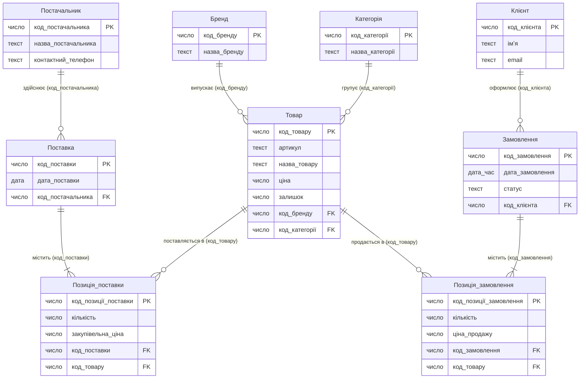
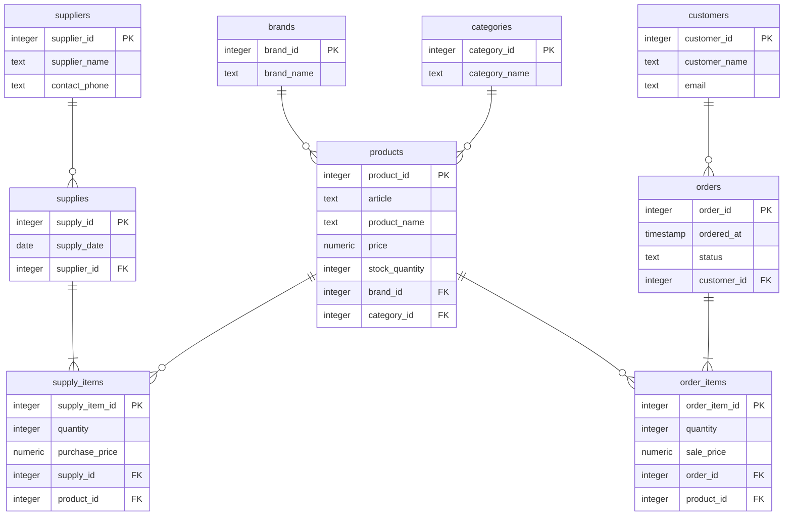

# Лабораторна робота №1. Моделювання предметної області та створення схеми бази даних

Виконавець: Борзенков Максим, СТСА-25-1.

Предметна область: Графіті шоп.


## 1. Магазин графіті-товарів продає художникам і любителям вуличного мистецтва фарби в балончиках, маркери, насадки (кепи) та аксесуари. Товари надходять від постачальників, зберігаються на складі й продаються клієнтам через замовлення. Із часом відбуваються події: постачальник привозить партію, клієнт оформлює замовлення, замовлення змінює статус (нове, оплачене, відправлене, скасоване), а залишок товару зменшується. Власник вирішує, що закупити в постачальників, яких брендів потрібен більший запас, які ціни встановити і кого вважати постійними клієнтами.


## 2. Бізнес-правила

| № | Правило | Де перевіряється | Обмеження або обґрунтування |
|---|---|---|---|
| 1 | Якщо ціна товару не більша за нуль, то товар не додається | схема | `CHECK (price > 0)` |
| 2 | Якщо кількість у позиції замовлення не додатна, то позиція не зберігається | схема | `CHECK (quantity > 0)` |
| 3 | Якщо два товари мають однаковий артикул, то другий не додається | схема | `UNIQUE` на артикул |
| 4 | Якщо за брендом закріплені товари, то бренд не можна видалити | схема | `REFERENCES ... ON DELETE RESTRICT` |
| 5 | Якщо в замовлення не вказано клієнта, то воно не створюється | схема | `NOT NULL` і `REFERENCES` |
| 6 | Якщо залишок товару став би від'ємним, то зміна не зберігається | схема | `CHECK (stock_quantity >= 0)` |
| 7 | Якщо email уже зареєстрований, то другий клієнт з таким email не додається | схема | `UNIQUE` на email |
| 8 | Якщо статус замовлення не належить до переліку (нове, оплачене, відправлене, скасоване), то замовлення не зберігається | схема | `CHECK (status IN (...))` |
| 9 | Якщо кількість у замовленні більша за залишок товару, то замовлення не оформлюється | програма | потрібно порівняти з даними іншої таблиці, а `CHECK` бачить лише свій рядок |
| 10 | Якщо замовлення скасоване, то залишок товарів повертається на склад | програма | це зміна кількох таблиць одразу |
| 11 | Якщо клієнт зробив 5 і більше замовлень за рік, то діє знижка | програма | потрібен підрахунок за іншою таблицею й поточною датою |


## 3. ER-модель




### Сутності

- **Бренд** - виробник товарів (наприклад, Montana, Molotow).
- **Категорія** - вид товару: балончик, маркер, кеп, аксесуар.
- **Товар** - позиція асортименту з ціною і залишком на складі.
- **Постачальник** - компанія, яка привозить товари в магазин.
- **Поставка** - факт надходження партії від постачальника в певну дату.
- **Позиція поставки** - окремий товар у поставці із кількістю та закупівельною ціною.
- **Клієнт** - покупець, який оформлює замовлення.
- **Замовлення** - покупка клієнта зі статусом (нове, оплачене, відправлене, скасоване).
- **Позиція замовлення** - окремий товар у замовленні з кількістю та ціною продажу.

### Звʼязки

- Один бренд випускає багато товарів - кожен товар належить одному бренду (1:N; участь товару обовʼязкова).
- Одна категорія групує багато товарів - кожен товар належить одній категорії (1:N; участь товару обовʼязкова).
- Один постачальник здійснює багато поставок - кожна поставка належить одному постачальнику (1:N; участь поставки обовʼязкова).
- Одна поставка містить багато позицій - кожна позиція належить одній поставці (1:N; участь позиції обовʼязкова).
- Один товар поставляється в багатьох позиціях поставок - кожна позиція поставки стосується одного товару (1:N; участь позиції обовʼязкова).
- Один клієнт оформлює багато замовлень - кожне замовлення належить одному клієнту (1:N; участь замовлення обовʼязкова).
- Одне замовлення містить багато позицій - кожна позиція належить одному замовленню (1:N; участь позиції обовʼязкова).
- Один товар продається в багатьох позиціях замовлень - кожна позиція замовлення стосується одного товару (1:N; участь позиції обовʼязкова).

Зв'язки «товар - поставка» і «товар - замовлення» типу M:N розкладено в асоціативні сутності «Позиція поставки» і «Позиція замовлення», бо вони мають власні атрибути (кількість, ціна).

### Перевірка за типовими помилками

- [x] атрибут, який насправді є сутністю
- [x] звʼязок без кардинальності
- [x] одна таблиця на багато стовпців замість кількох сутностей
- [x] телефон або електронна пошта як первинний ключ

Результат перевірки: бренд і категорію зроблено окремими сутностями; зв'язки M:N розкладено в асоціативні сутності; усі зв'язки мають кардинальність; первинні ключі - числові коди, email і телефон ключами не є.


## 4. Ключі та реакції на видалення

### Первинні ключі

| Сутність | Потенційні ключі | Первинний ключ | Обґрунтування |
|---|---|---|---|
| Бренд | код_бренду, назва_бренду | код_бренду | сурогатний: назву можуть змінити |
| Категорія | код_категорії, назва_категорії | код_категорії | сурогатний: назву можуть змінити |
| Товар | код_товару, артикул | код_товару | сурогатний: артикул може змінитися, унікальність артикула забезпечує UNIQUE |
| Постачальник | код_постачальника, назва_постачальника | код_постачальника | сурогатний: назва компанії може змінитися |
| Поставка | код_поставки | код_поставки | сурогатний: природного ключа немає |
| Позиція поставки | код_позиції_поставки, (код_поставки, код_товару) | код_позиції_поставки | сурогатний: простіший за складений |
| Клієнт | код_клієнта, email | код_клієнта | сурогатний: email можуть змінити, унікальність забезпечує UNIQUE |
| Замовлення | код_замовлення | код_замовлення | сурогатний: природного ключа немає |
| Позиція замовлення | код_позиції_замовлення, (код_замовлення, код_товару) | код_позиції_замовлення | сурогатний: простіший за складений |


### Реакції на видалення

| Звʼязок | Реакція | Обґрунтування з погляду бізнесу |
|---|---|---|
| Бренд - Товар | RESTRICT | бренд із товарами видаляти не можна, щоб не втратити асортимент |
| Категорія - Товар | RESTRICT | категорію з товарами видаляти не можна, щоб товари не лишилися без групи |
| Постачальник - Поставка | RESTRICT | історію закупівель потрібно зберігати |
| Поставка - Позиція поставки | CASCADE | позиція існує лише в межах поставки: видалена поставка забирає свої позиції |
| Товар - Позиція поставки | RESTRICT | товар, який постачали, видаляти не можна, щоб не втратити історію |
| Клієнт - Замовлення | RESTRICT | замовлення потрібні для обліку і знижок, тож клієнта з замовленнями видаляти не можна |
| Замовлення - Позиція замовлення | CASCADE | позиція існує лише в межах замовлення: видалене замовлення забирає свої позиції |
| Товар - Позиція замовлення | RESTRICT | товар, який продавали, видаляти не можна, щоб не втратити історію продажів |

SET NULL не використано: усі зовнішні ключі обовʼязкові (NOT NULL).## 5. Нормалізація


## 5. Нормалізація

### Функціональні залежності

1. код_замовлення → дата_замовлення, статус, email_клієнта
2. email_клієнта → імʼя_клієнта
3. артикул → назва_товару, ціна, назва_бренду, назва_категорії
4. (код_замовлення, артикул) → кількість, ціна_продажу
5. код_поставки → дата_поставки, код_постачальника
6. код_постачальника → назва_постачальника, контактний_телефон
7. код_бренду → назва_бренду
8. код_категорії → назва_категорії

### «Погана» таблиця

Таблиця `замовлення_всі_дані`, ключ (код_замовлення, артикул):

| код_замовлення | дата_замовлення | статус | імʼя_клієнта | email_клієнта | артикул | назва_товару | назва_бренду | назва_категорії | ціна | кількість | ціна_продажу |
|---|---|---|---|---|---|---|---|---|---|---|---|
| 1 | 2026-11-01 | нове | Олег | oleg@mail.com | MTN-001 | Montana Black | Montana | балончик | 220 | 3 | 220 |
| 2 | 2026-11-01 | нове | Олег | oleg@mail.com | MOL-010 | Molotow One4All | Molotow | маркер | 180 | 1 | 180 |
| 3 | 2026-11-03 | оплачене | Іра | ira@mail.com | MTN-001 | Montana Black | Montana | балончик | 220 | 2 | 220 |
| 4 | 2026-11-05 | нове | Олег | oleg@mail.com | CAP-005 | Кеп Fat | Montana | кеп | 15 | 10 | 15 |

### Аномалії

- Аномалія оновлення: змінюємо ціну товару MTN-001 - треба виправити кілька рядків; якщо виправити лише один, ціна одного товару в таблиці різна.
- Аномалія вставки: новий товар чи клієнта не можна додати, поки немає замовлення, бо код_замовлення входить у ключ.
- Аномалія видалення: видалили єдине замовлення 2 - зникли відомості про клієнтку Іру.

### Крок 1. 1NF

Отримані таблиці з ключами: `замовлення_всі_дані` (код_замовлення, артикул).

Знята проблема: усі значення атомарні, повторюваних груп немає, ключ визначено.

### Крок 2. 2NF

Отримані таблиці з ключами: `замовлення` (код_замовлення), `товари` (артикул), `позиції_замовлення` (код_замовлення, артикул).

Знята проблема: часткові залежності - дані замовлення залежать лише від код_замовлення, дані товару лише від артикула.

### Крок 3. 3NF

Отримані таблиці з ключами: `клієнти` (email_клієнта), `замовлення` (код_замовлення), `товари` (артикул), `позиції_замовлення` (код_замовлення, артикул).

Знята проблема: транзитивна залежність код_замовлення → email_клієнта → імʼя_клієнта; дані клієнта винесено в окрему таблицю.

### Звірка з ER-моделлю

Таблиці після 3NF збігаються із сутностями Клієнт, Замовлення, Товар і Позиція замовлення. У ER-моделі додатково виділено Бренд і Категорію (щоб назви не дублювалися й не писалися по-різному), а також Постачальника, Поставку і Позицію поставки - вони описують надходження товару, якого немає в «поганій» таблиці. У ER-моделі ключі сурогатні (коди), а в нормалізації використано природні.

### Денормалізація

Ціна_продажу в позиції замовлення дублює ціну товару свідомо: після зміни ціни старі замовлення мають зберігати ціну на момент покупки. Узгодженість підтримує програма, яка записує ціну при створенні позиції.


## 6. Реляційна схема



## 7. Середовище

Операційна система: Windows 11.

```powershell
docker compose up -d
docker compose ps
```

```text
NAME              IMAGE           COMMAND                  SERVICE    CREATED      STATUS         PORTS
dbsa-postgres-1   postgres:18.6   "docker-entrypoint.s…"   postgres   2 days ago   Up 8 seconds   0.0.0.0:5432->5432/tcp, [::]:5432->5432/tcp
```

Підключення pgAdmin: сервер localhost, порт 5432, база dbsa, користувач student.

Перевірка тому: виконано `docker compose down` і `docker compose up -d`. Після перезапуску в базі dbsa у схемі public лишилося 9 таблиць, дані не втрачено.


## 8. Створення схеми

- Міграція 001: [migrations/001_create_schema.up.sql](migrations/001_create_schema.up.sql), [migrations/001_create_schema.down.sql](migrations/001_create_schema.down.sql)
- Первинні ключі всіх таблиць - стовпці ідентичності `GENERATED ALWAYS AS IDENTITY`: код видає СУБД, а не користувач.
- Умови CHECK: `price > 0`, `stock_quantity >= 0`, `quantity > 0` (в обох позиціях), `purchase_price > 0`, `sale_price > 0` і `status IN ('нове', 'оплачене', 'відправлене', 'скасоване')`.
- Унікальність: `article` у товарів і `email` у клієнтів.
- Реакції на видалення: `ON DELETE CASCADE` для позицій замовлення і позицій поставки (позиція не існує без замовлення чи поставки), для всіх інших зовнішніх ключів - `ON DELETE RESTRICT`.


## 9. Перевірка обмежень

Файл перевірок: [constraint-checks.sql](constraint-checks.sql)

| № | Правило | Обмеження | Повідомлення СУБД |
|---|---|---|---|
| 1 | Замовлення без клієнта не створюється | NOT NULL | `ERROR: null value in column "customer_id" of relation "orders" violates not-null constraint` |
| 2 | Email клієнта не повторюється | UNIQUE | `ERROR: duplicate key value violates unique constraint "customers_email_key"` |
| 3 | Ціна товару більша за нуль | CHECK | `ERROR: new row for relation "products" violates check constraint "products_price_check"` |
| 4 | Статус замовлення з дозволеного переліку | CHECK | `ERROR: new row for relation "orders" violates check constraint "orders_status_check"` |
| 5 | Замовлення посилається на існуючого клієнта | REFERENCES | `ERROR: insert or update on table "orders" violates foreign key constraint "orders_customer_id_fkey"` |
| 6 | Первинний ключ бренду не повторюється | PRIMARY KEY | `ERROR: duplicate key value violates unique constraint "brands_pkey"` |


## 10. Цикл up - down - up

Результат скрипта перевірки схеми в базі dbsa_check після виконання файлів up:

```text
"table_name"	"kind"	"name"	"definition"
"brands"	"стовпець"	"brand_id"	"integer NOT NULL GENERATED AS IDENTITY"
"brands"	"стовпець"	"brand_name"	"text NOT NULL"
"brands"	"PRIMARY KEY"	"brands_pkey"	"PRIMARY KEY (brand_id)"
"categories"	"стовпець"	"category_id"	"integer NOT NULL GENERATED AS IDENTITY"
"categories"	"стовпець"	"category_name"	"text NOT NULL"
"categories"	"PRIMARY KEY"	"categories_pkey"	"PRIMARY KEY (category_id)"
"customers"	"стовпець"	"customer_id"	"integer NOT NULL GENERATED AS IDENTITY"
"customers"	"стовпець"	"customer_name"	"text NOT NULL"
"customers"	"стовпець"	"email"	"text NOT NULL"
"customers"	"PRIMARY KEY"	"customers_pkey"	"PRIMARY KEY (customer_id)"
"customers"	"UNIQUE"	"customers_email_key"	"UNIQUE (email)"
"order_items"	"стовпець"	"order_item_id"	"integer NOT NULL GENERATED AS IDENTITY"
"order_items"	"стовпець"	"quantity"	"integer NOT NULL"
"order_items"	"стовпець"	"sale_price"	"numeric NOT NULL"
"order_items"	"стовпець"	"order_id"	"integer NOT NULL"
"order_items"	"стовпець"	"product_id"	"integer NOT NULL"
"order_items"	"PRIMARY KEY"	"order_items_pkey"	"PRIMARY KEY (order_item_id)"
"order_items"	"FOREIGN KEY"	"order_items_order_id_fkey"	"FOREIGN KEY (order_id) REFERENCES orders(order_id) ON DELETE CASCADE"
"order_items"	"FOREIGN KEY"	"order_items_product_id_fkey"	"FOREIGN KEY (product_id) REFERENCES products(product_id) ON DELETE RESTRICT"
"order_items"	"CHECK"	"order_items_quantity_check"	"CHECK ((quantity > 0))"
"order_items"	"CHECK"	"order_items_sale_price_check"	"CHECK ((sale_price > (0)::numeric))"
"orders"	"стовпець"	"order_id"	"integer NOT NULL GENERATED AS IDENTITY"
"orders"	"стовпець"	"ordered_at"	"timestamp without time zone NOT NULL"
"orders"	"стовпець"	"status"	"text NOT NULL"
"orders"	"стовпець"	"customer_id"	"integer NOT NULL"
"orders"	"PRIMARY KEY"	"orders_pkey"	"PRIMARY KEY (order_id)"
"orders"	"FOREIGN KEY"	"orders_customer_id_fkey"	"FOREIGN KEY (customer_id) REFERENCES customers(customer_id) ON DELETE RESTRICT"
"orders"	"CHECK"	"orders_status_check"	"CHECK ((status = ANY (ARRAY['нове'::text, 'оплачене'::text, 'відправлене'::text, 'скасоване'::text])))"
"products"	"стовпець"	"product_id"	"integer NOT NULL GENERATED AS IDENTITY"
"products"	"стовпець"	"article"	"text NOT NULL"
"products"	"стовпець"	"product_name"	"text NOT NULL"
"products"	"стовпець"	"price"	"numeric NOT NULL"
"products"	"стовпець"	"stock_quantity"	"integer NOT NULL"
"products"	"стовпець"	"brand_id"	"integer NOT NULL"
"products"	"стовпець"	"category_id"	"integer NOT NULL"
"products"	"PRIMARY KEY"	"products_pkey"	"PRIMARY KEY (product_id)"
"products"	"UNIQUE"	"products_article_key"	"UNIQUE (article)"
"products"	"FOREIGN KEY"	"products_brand_id_fkey"	"FOREIGN KEY (brand_id) REFERENCES brands(brand_id) ON DELETE RESTRICT"
"products"	"FOREIGN KEY"	"products_category_id_fkey"	"FOREIGN KEY (category_id) REFERENCES categories(category_id) ON DELETE RESTRICT"
"products"	"CHECK"	"products_price_check"	"CHECK ((price > (0)::numeric))"
"products"	"CHECK"	"products_stock_quantity_check"	"CHECK ((stock_quantity >= 0))"
"suppliers"	"стовпець"	"supplier_id"	"integer NOT NULL GENERATED AS IDENTITY"
"suppliers"	"стовпець"	"supplier_name"	"text NOT NULL"
"suppliers"	"стовпець"	"contact_phone"	"text NOT NULL"
"suppliers"	"PRIMARY KEY"	"suppliers_pkey"	"PRIMARY KEY (supplier_id)"
"supplies"	"стовпець"	"supply_id"	"integer NOT NULL GENERATED AS IDENTITY"
"supplies"	"стовпець"	"supply_date"	"date NOT NULL"
"supplies"	"стовпець"	"supplier_id"	"integer NOT NULL"
"supplies"	"PRIMARY KEY"	"supplies_pkey"	"PRIMARY KEY (supply_id)"
"supplies"	"FOREIGN KEY"	"supplies_supplier_id_fkey"	"FOREIGN KEY (supplier_id) REFERENCES suppliers(supplier_id) ON DELETE RESTRICT"
"supply_items"	"стовпець"	"supply_item_id"	"integer NOT NULL GENERATED AS IDENTITY"
"supply_items"	"стовпець"	"quantity"	"integer NOT NULL"
"supply_items"	"стовпець"	"purchase_price"	"numeric NOT NULL"
"supply_items"	"стовпець"	"supply_id"	"integer NOT NULL"
"supply_items"	"стовпець"	"product_id"	"integer NOT NULL"
"supply_items"	"PRIMARY KEY"	"supply_items_pkey"	"PRIMARY KEY (supply_item_id)"
"supply_items"	"FOREIGN KEY"	"supply_items_product_id_fkey"	"FOREIGN KEY (product_id) REFERENCES products(product_id) ON DELETE RESTRICT"
"supply_items"	"FOREIGN KEY"	"supply_items_supply_id_fkey"	"FOREIGN KEY (supply_id) REFERENCES supplies(supply_id) ON DELETE CASCADE"
"supply_items"	"CHECK"	"supply_items_purchase_price_check"	"CHECK ((purchase_price > (0)::numeric))"
"supply_items"	"CHECK"	"supply_items_quantity_check"	"CHECK ((quantity > 0))"
```

Після виконання файлів down: після down результат порожній;

Після повторного виконання файлів up: результат збігається з першим;

Висновок звірки з діаграмою розділу 6: таблиці, стовпці, типи, ключі й реакції на видалення збігаються з діаграмою розділу 6.

Результат перевірки схеми містить 9 таблиць, 34 стовпці, 9 первинних ключів, 8 зовнішніх ключів з явним ON DELETE (6 RESTRICT і 2 CASCADE), 2 обмеження UNIQUE і 7 обмежень CHECK. Назви таблиць і стовпців, типи, ключі та звʼязки збігаються з діаграмою розділу 6, рядків «УВАГА» немає; таблиці також відповідають сутностям ER-моделі розділу 3. Після down результат порожній, після повторного up він збігається з першим.