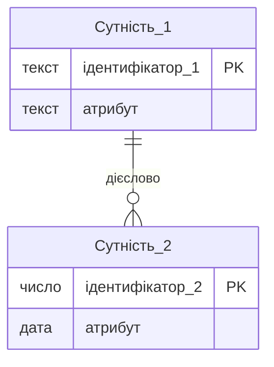
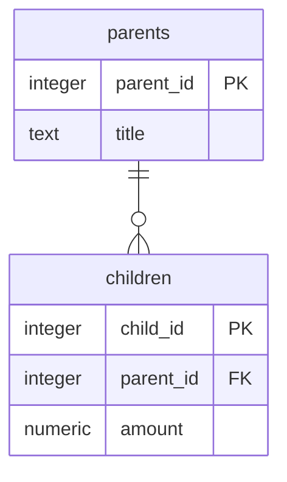

# Лабораторна робота №1. Моделювання предметної області та створення схеми бази даних

Виконавець: Борзенков Максим, СТСА-25-1.

Предметна область: Графіті шоп.


## 1. Магазин графіті-товарів продає художникам і любителям вуличного мистецтва фарби в балончиках, маркери, насадки (кепи) та аксесуари. Товари надходять від постачальників, зберігаються на складі й продаються клієнтам через замовлення. Із часом відбуваються події: постачальник привозить партію, клієнт оформлює замовлення, замовлення змінює статус (нове, оплачене, відправлене, скасоване), а залишок товару зменшується. Власник вирішує, що закупити в постачальників, яких брендів потрібен більший запас, які ціни встановити і кого вважати постійними клієнтами.


## 2. Бізнес-правила

| № | Правило | Де перевіряється | Обмеження або обґрунтування |
|---|---|---|---|
| 1 | Якщо ціна товару не більша за нуль, то товар не додається | схема | `CHECK (price > 0)` |
| 2 | Якщо кількість у позиції замовлення не додатна, то позиція не зберігається | схема | `CHECK (quantity > 0)` |
| 3 | Якщо два товари мають однаковий артикул, то другий не додається | схема | `UNIQUE` на артикул |
| 4 | Якщо за брендом закріплені товари, то бренд не можна видалити | схема | `REFERENCES ... ON DELETE RESTRICT` |
| 5 | Якщо в замовлення не вказано клієнта, то воно не створюється | схема | `NOT NULL` і `REFERENCES` |
| 6 | Якщо залишок товару став би від'ємним, то зміна не зберігається | схема | `CHECK (stock_quantity >= 0)` |
| 7 | Якщо email уже зареєстрований, то другий клієнт з таким email не додається | схема | `UNIQUE` на email |
| 8 | Якщо статус замовлення не належить до переліку (нове, оплачене, відправлене, скасоване), то замовлення не зберігається | схема | `CHECK (status IN (...))` |
| 9 | Якщо кількість у замовленні більша за залишок товару, то замовлення не оформлюється | програма | потрібно порівняти з даними іншої таблиці, а `CHECK` бачить лише свій рядок |
| 10 | Якщо замовлення скасоване, то залишок товарів повертається на склад | програма | це зміна кількох таблиць одразу |
| 11 | Якщо клієнт зробив 5 і більше замовлень за рік, то діє знижка | програма | потрібен підрахунок за іншою таблицею й поточною датою |

## 3. ER-модель

<!--
Концептуальна модель: назви українською, загальні типи (текст, число, дата, дата_час, логічне). Ідентифікатор - PK.
Кардинальність: || рівно один, |o нуль або один, }| один або багато, }o нуль або багато
(з правого боку звʼязку - дзеркально: ||, o|, |{, o{).
-->



### Сутності

- **Сутність_1** - одне речення про те, що це за обʼєкт або подія.

### Звʼязки

- Одна Сутність_1 має багато Сутностей_2 - кожна Сутність_2 належить одній Сутності_1 (1:N; участь Сутності_2 обовʼязкова).

<!-- Узагальнення (EER), якщо воно є: загальна сутність, підтипи та їхні власні атрибути. -->

### Перевірка за типовими помилками

- [ ] атрибут, який насправді є сутністю
- [ ] звʼязок без кардинальності
- [ ] одна таблиця на багато стовпців замість кількох сутностей
- [ ] телефон або електронна пошта як первинний ключ

Результат перевірки: що знайдено і як виправлено.

## 4. Ключі та реакції на видалення

### Первинні ключі

| Сутність | Потенційні ключі | Первинний ключ | Обґрунтування |
|---|---|---|---|
| Сутність_1 | ... | ... | природний чи сурогатний і чому |

### Реакції на видалення

| Звʼязок | Реакція | Обґрунтування з погляду бізнесу |
|---|---|---|
| Сутність_1 - Сутність_2 | RESTRICT / CASCADE / SET NULL | що станеться з повʼязаними даними |

## 5. Нормалізація

### Функціональні залежності

1. X → Y

### «Погана» таблиця

<!-- Одна широка таблиця, щонайменше десять стовпців, 3-5 рядків прикладу. -->

| Стовпець 1 | Стовпець 2 | ... |
|---|---|---|
| ... | ... | ... |

### Аномалії

- Аномалія оновлення: конкретна дія і що піде не так.
- Аномалія вставки: конкретна дія і що піде не так.
- Аномалія видалення: конкретна дія і що піде не так.

### Крок 1. 1NF

Отримані таблиці з ключами: ...

Знята проблема: ...

### Крок 2. 2NF

Отримані таблиці з ключами: ...

Знята проблема: ...

### Крок 3. 3NF

Отримані таблиці з ключами: ...

Знята проблема: ...

### Звірка з ER-моделлю

Чи збігаються таблиці після 3NF із сутностями розділу 3; пояснення розбіжностей.

### Денормалізація

<!-- Що дублюється, навіщо і хто підтримує узгодженість. Якщо свідомої денормалізації немає, так і записати. -->

## 6. Реляційна схема

<!--
Назви таблиць і стовпців - точно як у SQL: англійською, малими літерами, через підкреслення; таблиці в множині.
Типи PostgreSQL без параметрів (numeric, а не numeric(8, 2)). Ключі: PK, FK, «PK, FK».
-->



## 7. Середовище

Операційна система: Windows / macOS / Linux.

```bash
docker compose up -d
docker compose ps
```

```text
вивід docker compose ps
```

Підключення pgAdmin: сервер localhost, порт 5432, база dbsa, користувач student.

Перевірка тому: команди `docker compose down` і `docker compose up -d`, стан таблиць після перезапуску.

## 8. Створення схеми

- Міграція 001: [migrations/001_create_schema.up.sql](migrations/001_create_schema.up.sql), [migrations/001_create_schema.down.sql](migrations/001_create_schema.down.sql)
- Рішення, яких не видно з діаграми: умови CHECK, реакції на видалення, стовпці ідентичності.

## 9. Перевірка обмежень

Файл перевірок: [constraint-checks.sql](constraint-checks.sql)

| № | Правило | Обмеження | Повідомлення СУБД |
|---|---|---|---|
| 1 | ... | NOT NULL | `ERROR: null value in column ...` |
| 2 | ... | UNIQUE | `ERROR: duplicate key value violates unique constraint ...` |
| 3 | ... | CHECK | `ERROR: new row for relation ... violates check constraint ...` |
| 4 | ... | REFERENCES | `ERROR: insert or update on table ... violates foreign key constraint ...` |
| 5 | ... | PRIMARY KEY | `ERROR: duplicate key value violates unique constraint ..._pkey` |

## 10. Цикл up - down - up

Результат скрипта перевірки схеми в базі dbsa_check після виконання файлів up:

```text
вставити результат разом із заголовками стовпців
```

Після виконання файлів down: результат порожній / що лишилося.

Після повторного виконання файлів up: результат збігається з першим / чим відрізняється.

Висновок звірки з діаграмою розділу 6: ...
